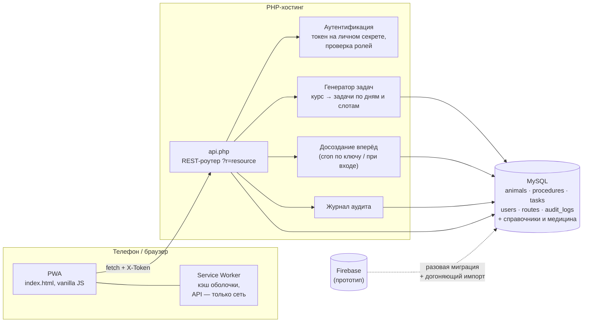

# Трекер ветеринарных назначений и учёт животных приюта

Мобильное веб-приложение (PWA) для приюта: ветеринар назначает курс лечения — система сама раскладывает его на ежедневные задачи для волонтёров и сотрудников, следит за выполнением, сроками курсов и ведёт журнал всех изменений. Вокруг трекера вырос полноценный учёт животных: вакцинации, стерилизации, доноры крови, пристройство, справочники и отчёты.

> Опубликовано в обезличенном виде: удалены данные животных, сотрудников, ключи и адреса серверов. Сид-данные заменены вымышленными.

## Задача

Приют для животных, около 200 животных под наблюдением одновременно, команда ветеринаров и волонтёров (около двух десятков учётных записей). До проекта назначения жили в бумажных листах и чатах, а затем — в прототипе на Firebase, который перестал справляться:

- бессрочные курсы «терялись»: задачи на них переставали появляться, и животное молча выпадало из обхода;
- периодичность («через день», «по вторникам», «5 дней приём / 2 пауза») не соблюдалась;
- не было разграничения прав и истории — непонятно, кто и когда поменял дозировку или закрыл курс;
- волонтёры работают с телефона в помещениях со слабой связью.

Нужно было перенести систему на собственный хостинг (PHP + MySQL) без потери истории и без остановки работы приюта, а затем развивать её до единого учёта животных.

## Возможности по ролям

| Роль | Что может |
|---|---|
| **Исполнитель** (`executor`) — волонтёр, санитар | Видит задачи на день по маршрутам и временным слотам, отмечает выполнение с комментарием, перемещает животных между местами (пересадка), смотрит карточку животного |
| **Администратор приюта** (`shelterAdmin`) | Всё, что исполнитель, плюс назначения, справочники, журнал изменений, аналитика, пристройство, отчёты |
| **Ветеринар** (`doctor`) | Создаёт, редактирует, продлевает и завершает курсы; вакцинации, ХВИ-тесты, стерилизации, донации и переливания крови; заводит сотрудников и меняет пароли |
| **Техадмин** (`techAdmin`) | Полный доступ, управление ролями (включая назначение техадминов), обслуживающие операции |

Ключевые экраны:

- **Задачи дня** — список по маршрутам (карантин, блоки содержания и т. п.) и слотам времени, фильтры, навигация по датам, счётчики, печать.
- **Назначения** — курсы с любой периодичностью (ежедневно, раз в N дней, по дням недели, по числам месяца, ежегодно, циклами «приём/пауза»), автоподсказка препарата из справочника, контроль окончания курсов, вкладка «Требуют проверки» для бессрочных курсов без отметок.
- **Карточка животного** — паспортные данные, аллергии, группа крови, ХВИ/лейкемия, история назначений, вакцинаций, тестов, стерилизаций, донаций; печать медкарты и паспорта прививок.
- **Медицина** — ХВИ-тесты (результат автоматически проставляет статус в карточке), подбор доноров крови по критериям с объяснением, что мешает каждому кандидату, переливания с привязкой получателя.
- **Пристройство** — статусы, каналы размещения объявлений, напоминания об обновлении, подбор животного под запрос посетителя, предупреждения при размещении уязвимых животных.
- **Справочники** — препараты, места, маршруты, типы вакцинаций, каналы, статусы; поиск дублей с тремя уровнями уверенности и слиянием с переносом всех ссылок.
- **Отчёты и аналитика** — выдача препаратов (кто, когда, кому), вакцинации, стерилизации, выбытие за период; выгрузка CSV (с BOM для Excel) и печать.
- **Журнал изменений** — кто, что и когда изменил, с «было/стало».

## Архитектура



## Стек

- **Фронтенд:** vanilla JavaScript, HTML/CSS без фреймворков и сборки, PWA (manifest, service worker, maskable-иконки, установка на домашний экран).
- **Бэкенд:** PHP 8, PDO, единая точка входа `api.php` с роутингом по ресурсу.
- **База:** MySQL 8 (utf8mb4), самомигрирующаяся схема для новых модулей.
- **Хостинг:** обычный shared-хостинг с Apache (`.htaccess`), cron для обслуживающих задач.

## Инженерные решения

**Генерация ежедневных задач из курсов.** Каждый курс превращается в набор задач `(процедура, животное, дата, слот)`. Функция `isActiveOnDate` считает смещение от *начала курса*, а не от сегодняшнего дня — иначе «через день» сдвигался бы, если назначение завели с опозданием. Поддерживаются шесть типов периодичности, включая циклы «N дней приёма / M дней паузы × K циклов». Горизонт генерации ограничен 120 днями, чтобы бессрочный курс не заливал таблицу задачами на годы вперёд; прошлые дни не заполняются.

**Идемпотентное досоздание задач.** Для бессрочных курсов задачи добираются до горизонта отдельной функцией `topUpTasks`: её вызывает cron по ключу и само приложение раз в сутки. Повторный запуск ничего не дублирует благодаря `UNIQUE (procedure_id, animal_id, date, time_of_day)` и `INSERT IGNORE`. Досоздание начинается с *завтрашнего* дня — дописывать задачи в текущий день нельзя, они сразу попали бы в «просроченные» и исказили картину. После внедрения число курсов без будущих задач упало примерно с 500 до 20.

**Корректное закрытие и продление курсов.** При завершении/продлении невыполненные задачи за пределами нового срока удаляются, а выполненные не трогаются никогда — это запись о фактически введённом препарате. Деактивация животного закрывает его курсы и снимает будущие задачи.

**Ролевая модель и сессии.** Четыре роли, проверка на сервере через `requireRole([...])` на каждом эндпоинте; интерфейс прячет недоступные разделы, но источником истины остаётся API. Защита от снятия прав самому себе и от удаления последнего техадмина. Токен — `sha256(id : личный секрет)`: смена пароля меняет секрет и мгновенно отзывает все сессии пользователя. Проверка токенов включалась через «рубильник» `AUTH_ENFORCE` — сначала режим наблюдения, затем блокировка, чтобы никого не выбросить посреди смены.

**Бесшовный переход на bcrypt.** В прототипе пароли хранились как SHA-256 без соли. Новая система принимает старый формат и при первом успешном входе молча перехеширует пароль в bcrypt — без массового сброса паролей.

**Офлайн и плохая сеть.** Service worker кэширует оболочку приложения (network-first для навигации, cache-first для статики), но *никогда* не кэширует ответы API — медкарта и назначения всегда свежие. Клиентский `apiFetch` различает отказ сервера и потерю сети: при обрыве связи сессия не сбрасывается, записывающие запросы повторяются, а вход пропускается по кэшу. Принудительный HTTPS нужен, чтобы iOS разрешала установку PWA и сохранение пароля.

**Журнал аудита.** Все значимые действия (создание/изменение/удаление назначений, животных, сотрудников, справочников, слияния дублей, системное досоздание задач) пишутся в `audit_logs` с автором и описанием; при миграции добавлена колонка `details` для «было/стало».

**Миграция Firebase → MySQL.** Основной перенос выполнен дампом, после чего прототип ещё какое-то время продолжал принимать отметки. Расхождение догоняется скриптами из [`migration/`](migration):
- `import.php` — холостой прогон по умолчанию, запись только с `--apply` и одной транзакцией; перед записью — проверка ссылочной целостности (животное, процедура, исполнитель, автор записи журнала); DDL выполняется строго *до* транзакции, потому что в MySQL он неявно её фиксирует; задачи сопоставляются не по id, а по бизнес-ключу (процедура, животное, дата, слот), чтобы не задвоить слоты, уже созданные новой системой; дубли учётных записей сливаются.
- `fix_stale.php` — догоняет задачи, получившие отметку в старой системе уже после переезда.

**Справочники и дубли.** Справочник препаратов наполнен из ~1500 реальных назначений: для каждого названия берётся самая частая комбинация группы, пути введения, периодичности и слота, а доза намеренно не переносится — она зависит от веса конкретного животного. Поиск дублей сравнивает кириллицу посимвольно и предлагает три уровня уверенности, чтобы не слить разное оптом.

**Безопасность конфигурации.** Доступы к БД и секреты читаются только из `config.php` вне репозитория (шаблон — `config.example.php`), предпочтительно выше веб-корня; `.htaccess` запрещает отдачу конфига и дампов по HTTP даже при отключённом PHP. Отладочные эндпоинты сокращены до smoke-теста без раскрытия данных.

## История развития

Проект развивался итерациями по техническим заданиям v3.0–v4.0:

- **Перенос с прототипа.** Исходное состояние с боевого сервера, включение проверки токенов и ролей, удаление отладочных страниц, токен сессии хранится только в памяти, если не отмечено «запомнить меня».
- **Рабочие экраны на реальных данных.** Задачи, животные, назначения, окончания курсов, отчёты и аналитика вместо моковых данных; индексы БД, включая уникальный ключ задач.
- **Критические исправления генератора.** Соблюдение периодичности (раньше задачи создавались ежедневно независимо от настройки) и досоздание вперёд для бессрочных курсов.
- **История выдачи препаратов и журнал изменений**, отчёт «кто сегодня где работает», выгрузки CSV и печать.
- **Безопасность.** Переход на bcrypt без сброса, токены на личном секрете с отзывом, вынос доступов к БД из кода.
- **Управление сотрудниками и права.** Форма с ролями и их описанием, автогенерация логина из фамилии, расширение доступа ветеринарам и администратору приюта.
- **Устойчивость к плохой сети.** Автовход больше не стирает сессию при обрыве связи, повторы записывающих запросов.
- **Справочник препаратов** с автоподсказкой и проверкой дублей.
- **Пристройство:** статусы, каналы размещения, подбор животного под запрос, сводка координатора.
- **v3.0–v3.2 — вакцинации и обработки:** справочник типов, повторы автоматически создают задачи, отчёты по уникальным животным и дозам, паспорт прививок; причины выбытия и отчёт по выбытию.
- **v4.0 — сводное ТЗ:** маршруты и места стали редактируемыми справочниками (вместо зашитых в код), единый раздел «Справочники» со слиянием дублей, рабочий раздел «Медицина» (ХВИ-тесты, стерилизации, донации крови, подбор доноров, отчёт по стерилизациям).
- **Развитие трекера после переезда:** догоняющий импорт из Firebase, редактирование назначений с уборкой задач за концом курса, переливания с сохранением получателя, раздел пересадки для исполнителей, версия приложения в настройках, PWA-установка и вход через менеджер паролей.

## Структура репозитория

```
apps/
  treatment-tracker/   актуальная версия трекера назначений (PWA + API)
  shelter-registry/    расширенная система учёта приюта (ветка v3.2–v4.0)
migration/             скрипты догоняющего импорта Firebase → MySQL (без данных)
docs/
  schema.sql           базовая схема MySQL
  demo-seed.sql        вымышленные демо-данные
```

Обе версии в `apps/` имеют одинаковую структуру: `index.html` (всё приложение), `api.php`, `sw.js`, `manifest.webmanifest`, иконки, `.htaccess`, `config.example.php`.

## Локальный запуск

Нужны PHP 8.1+ (с `pdo_mysql`) и MySQL 8.

```bash
# 1. База и демо-данные
mysql -u root -e "CREATE DATABASE shelter CHARACTER SET utf8mb4; \
  CREATE USER 'shelter_app'@'localhost' IDENTIFIED BY 'local-dev'; \
  GRANT ALL ON shelter.* TO 'shelter_app'@'localhost';"
mysql -u root shelter < docs/schema.sql
mysql -u root shelter < docs/demo-seed.sql

# 2. Конфиг
cd apps/treatment-tracker
cp config.example.php config.php   # впишите db_pass = local-dev и случайный token_salt

# 3. Сервер
php -S localhost:8000
```

Откройте http://localhost:8000 и войдите демо-учёткой (`admin`, `petrova`, `sidorov` или `ivanova`, пароль `demo-pass-2026` — см. `docs/demo-seed.sql`). Недостающие таблицы и колонки API создаст сам при первом обращении. Задачи по демо-курсам появятся после первого входа или запроса `api.php?r=maintenance`.

Для регулярного досоздания задач на сервере задайте `maint_key` в `config.php` и добавьте в cron:

```bash
curl -s "https://<ваш-домен>/api.php?r=maintenance&key=<maint_key>"
```
